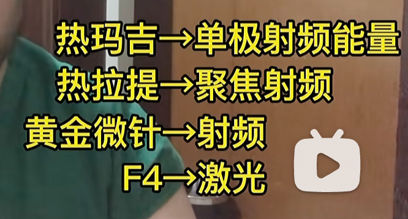
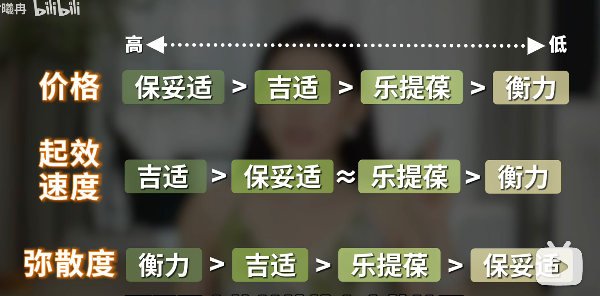
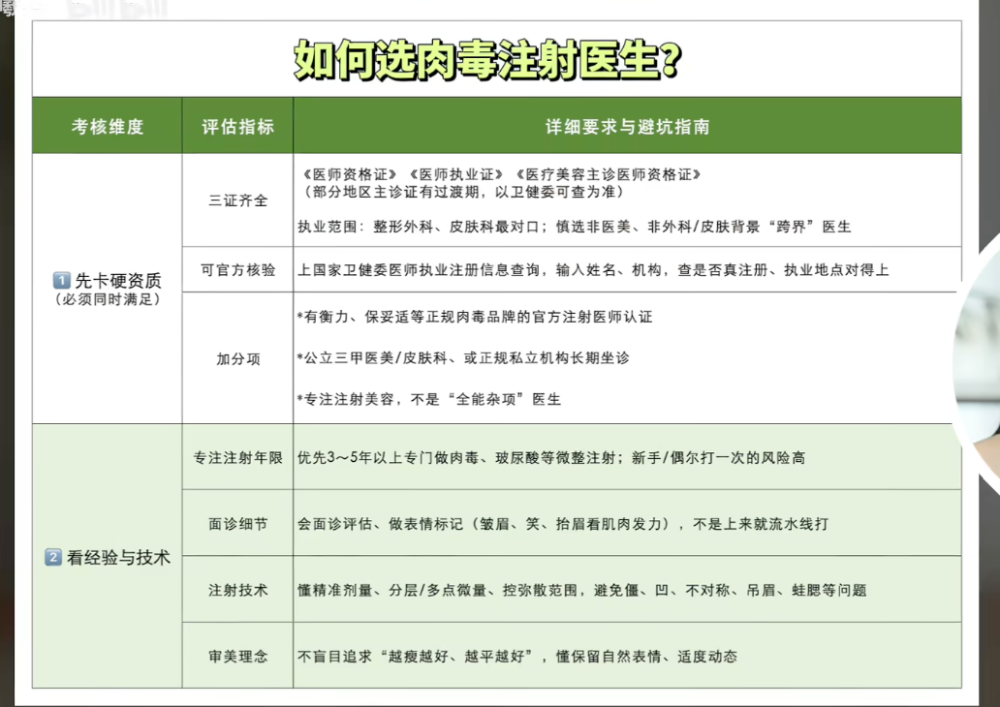
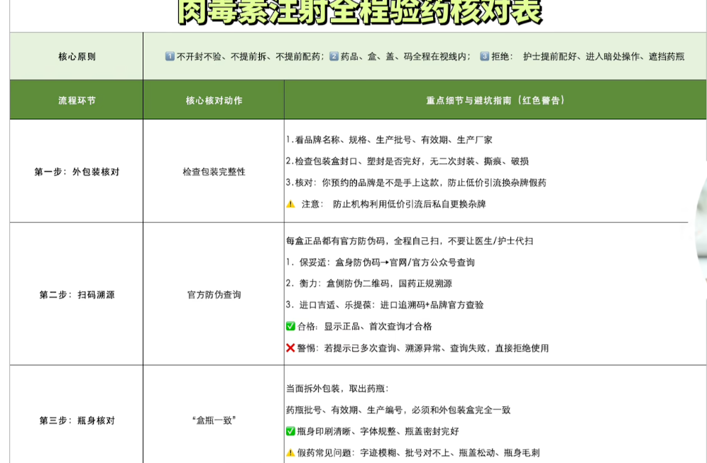
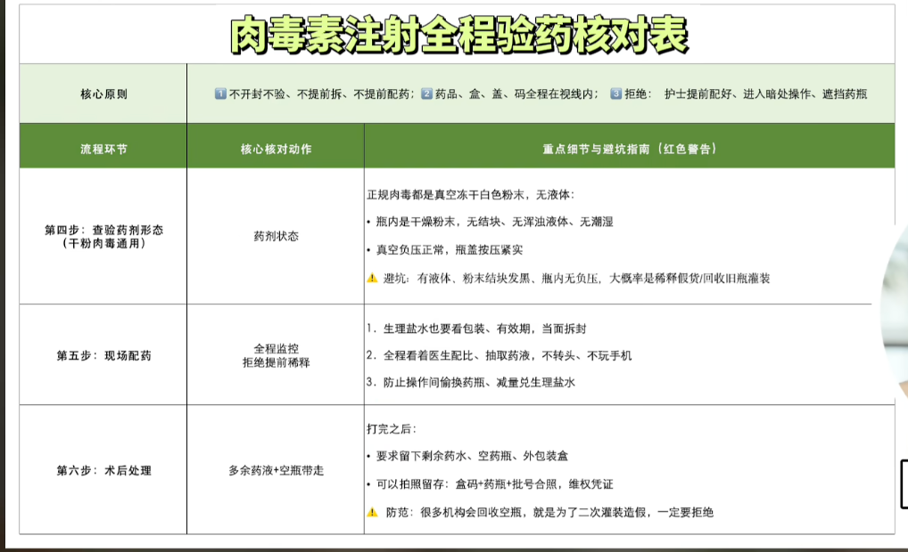

# 医美笔记

> 以下是收集的项目介绍、个人看法和报价记录，尚未逐项核实。项目适应证、风险、产品合规性和实际费用以正规医疗机构面诊及官方信息为准。

## 待了解的项目

- 热玛吉、超声类项目、鼻部与眼部项目（含提肌）、近视手术、发际线、牙齿矫正。
- 皮肤美白：超皮秒、光子嫩肤；记录中提到需关注能量与波长。
- 光电项目参考图：
- 原记录认为超声炮、热玛吉等效果相近，并提到“超声刀国内违法”；这两项判断需要核实，不能直接作为选择依据。

## 注射与填充

### 玻尿酸及其他填充材料

- 原记录列出的填充部位：额颞部、苹果肌、法令纹、颏部。
- 需考虑吸收、异物反应、长期补打成本；原记录认为长期费用可能高于脂肪填充。
- 其他提及的材料：少女针、童颜针等。不同产品的成分、适用部位和风险应分别核实。

### 肉毒素

**原记录提及的用途**：咬肌、下颌缘、眼角细纹、抬头纹，以及皮肤肉毒、唾液腺和皱纹治疗。咬肌两侧剂量可由医生根据实际情况评估。

**注意事项**：剂量过多可能导致表情僵硬；注射位置不当可能出现脸颊凹陷。原记录提到国产衡力弥散范围较大，适用部位需由医生判断。面诊时核对医生资质、产品与验药信息。

**参考图片**：

**历史报价记录（时间、币种及套餐范围待核实）**：

| 来源 | 原记录报价 | 备注 |
| --- | --- | --- |
| 北京协和 | 保妥适 100 U：1800；注射费：2000；衡力：660 | 原记录称包含全脸，需核实具体项目 |
| 医美机构 / 京东医美 | 美国品牌 50 U：1400；国产品牌 100 U：900 | 具体品牌和服务范围未记全 |
| 韩国 | 500–1000 | 币种未注明 |
| 瘦脸项目 | “50 U、2.9w–7.9w、150～六七百” | 原文数字含义不明，保留待核实 |

> 咨询时确认报价是否包含下颌缘提升、唾液腺等项目，避免把不同注射部位混为一个套餐。

## 按问题查找

### 法令纹

| 原记录分类 | 表现 / 可能原因 | 原记录提及的项目与提醒 |
| --- | --- | --- |
| 细纹型 | 干燥、卡粉，不笑时也有浅纹；可能与皮肤变薄有关 | 水光针，如丽珠兰、乔雅露蓝瓶、Jalupro；原记录称单次约维持 3 个月、需 3–4 次，均待核实。热玛吉也被提及。 |
| 结构性凹陷型 | 嘴凸、苹果肌扁平或鼻基底凹陷形成阴影 | 原记录倾向乔雅露黑瓶，提醒谨慎考虑玻尿酸填充及超声类项目；应先判断具体成因。 |
| 脂肪堆积 / 下垂型 | 法令纹上方组织堆积，形成阶梯感 | 原记录提及少量脂肪去除、线雕；效果与风险需由医生评估。 |

### 皮肤状态与水光针

| 项目 | 原记录中的定位 | 需确认的问题 |
| --- | --- | --- |
| 丽珠兰（Rejuran） | PN 类产品；针对干燥、泛红等肤质问题 | 产品成分、适应证、痛感与恢复期 |
| re2o | 无细胞真皮组织；原记录称注射层次较深 | 产品合规性、证据和风险 |
| Revive / Hilowave 等 | 透明质酸类补水项目；原记录提及交联剂 | 具体成分、残留与注射频次 |
| 乔雅露黑瓶 / 塑颜萃童颜针 | 胶原增生及增容类项目 | 适用部位、结节等不良反应 |

## 原记录中的慎选项目

以下是收集到的避雷观点，并非对所有人的统一结论：

1. **鼻部玻尿酸填充**：担心反复注射后扩散、鼻梁变宽或鼻尖形态变化。
2. **卧蚕填充**：担心材料移位、下眼睑形态变化及修复困难。
3. **鼻翼肉毒素**：原记录认为疼痛与预期效果可能不成比例。
4. **轮廓针 / 溶脂针**：原记录特别提醒核实是否含类固醇；不能靠药液清澈或浑浊判断成分，应查产品说明与资质。
5. **海藻焕肤 / 阿拉丁焕肤**：原记录提及疼痛、约两周脱皮瘙痒及皮肤屏障受损的担忧。

## 韩国医美：机构选择与面诊

- **选择机构**：避开咨询仓促、过度依赖低价引流的机构；优先安排实际操作医生面诊，确认由谁实施治疗。
- **购买疗程**：先了解单次项目的服务与恢复情况，再考虑多次套餐。
- **描述诉求**：提前写清最想改善的部位，例如侧颧骨或鼻基底；请医生解释成因、方案和预期变化。
- **比较方案**：组合项目时询问“只做其中一项，与两项一起做，视觉差异是什么？”并确认费用、恢复期和风险。
- **警惕推销**：对临时增加项目的建议，要求说明必要性。

## 男士项目分级（韩国皮肤科院长观点摘录）

> 这是原记录转述的一位院长的主观分级，不代表项目对个人的适应证或推荐顺序。

| 等级 | 项目 | 原记录中的理由或限制 |
| --- | --- | --- |
| D | Emface、颈纹玻尿酸、V-olet 轮廓针 | 认为男士入门性价比低；V-olet 可能肿胀、淤青、疼痛且需反复治疗。 |
| C | 丽珠兰、钛提升 | 认为部分男士效果不明显或痛感较强；胡须浓、肤色较深者做钛提升可能更疼。 |
| B | 热玛吉、Density、Oligio X、Inmode | 效果与皮肤厚度、脂肪量有关；需考虑疼痛、痕迹及恢复期。 |
| B | 胶原增强剂（乔雅露、Sculptra、Radiesse） | 原记录认为更适合面部脂肪少、侧脸凹陷者。 |
| B | 色素 / 血管 / CO₂ 激光 | 分别对应色斑、红血丝、小痣等问题；原记录提及可能需要多次治疗。 |
| A | Onda、Shurink | 原记录认为可考虑用于双下巴、下颌线；效果、次数和价格需评估。 |
| A | 水光针 + 针状射频 | 原记录提及乔雅露、外泌体、Potenza、Sylfirm X，用于毛孔、痘坑、出油等诉求；各产品证据和合规性需分别核实。 |
| A | 皮肤肉毒、脸部 / 胡须激光脱毛 | 原记录称皮肤肉毒可改善出油、毛孔，约维持 3 个月；脱毛被描述为半永久。 |
| S | Ultherapy、咬肌肉毒、唾液腺肉毒、皱纹肉毒 | 原记录认为满意度较高；分别针对松弛 / 下颌线、咬肌、唾液腺、动态皱纹。 |

原记录还提到：Ultherapy 对下半脸提升较明显；咬肌肉毒约维持 6 个月；唾液腺肉毒涉及耳下腺与颌下腺；皱纹肉毒更适合动态纹预防。这些效果和维持时间因人而异，需要面诊确认。

## 面诊核对清单

- [ ] 明确最想解决的问题，并区分肤质、肌肉、脂肪、松弛和骨性结构因素。
- [ ] 确认操作医生资质、机构资质、产品名称及正规来源。
- [ ] 问清预期效果、可能的不良反应、恢复期、维持时间和替代方案。
- [ ] 核对总费用、剂量 / 发数、注射部位、是否包含复诊，以及套餐限制。
